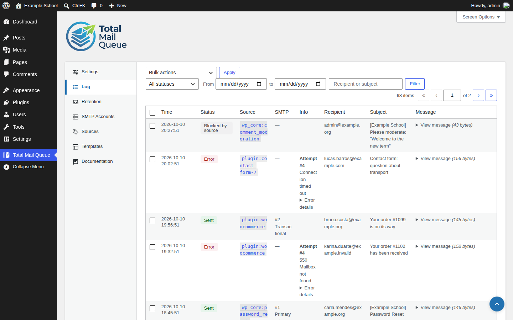
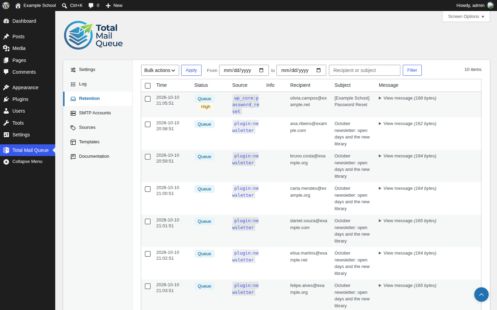
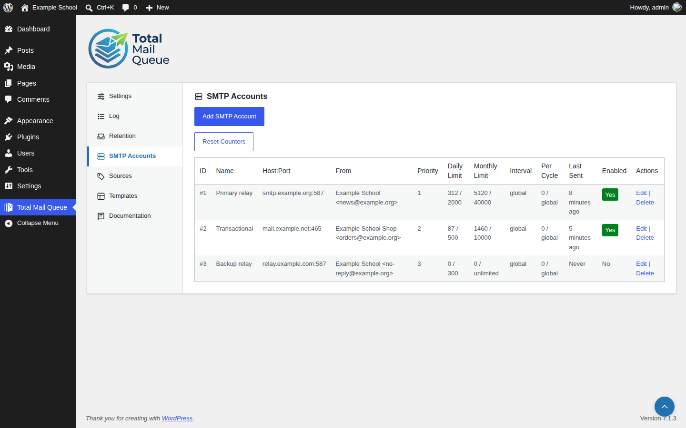
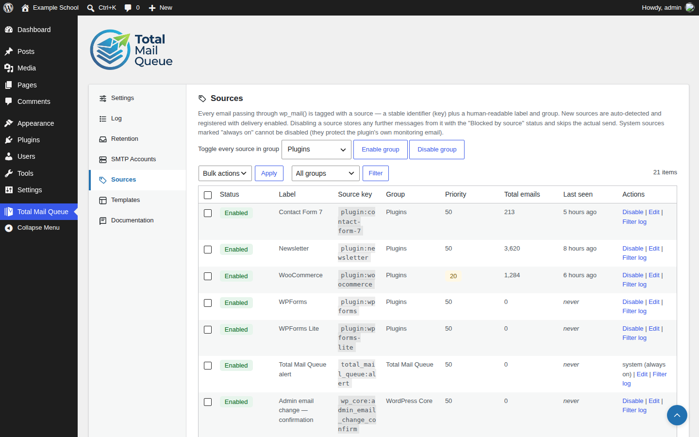
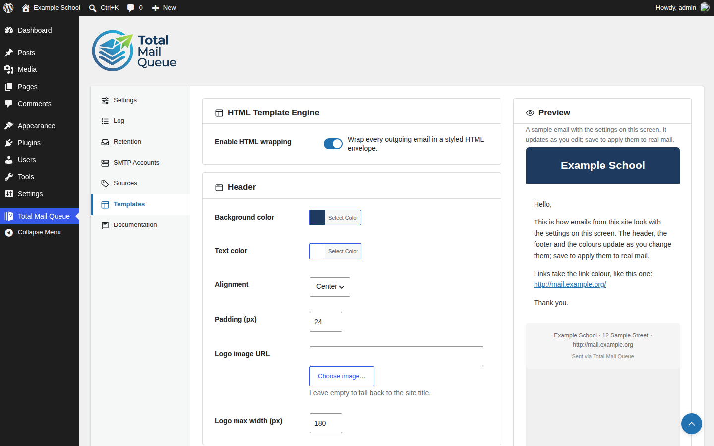
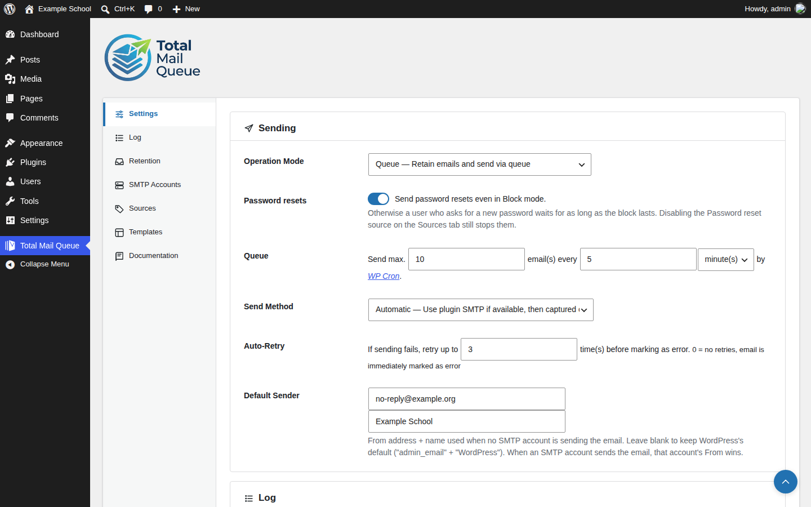
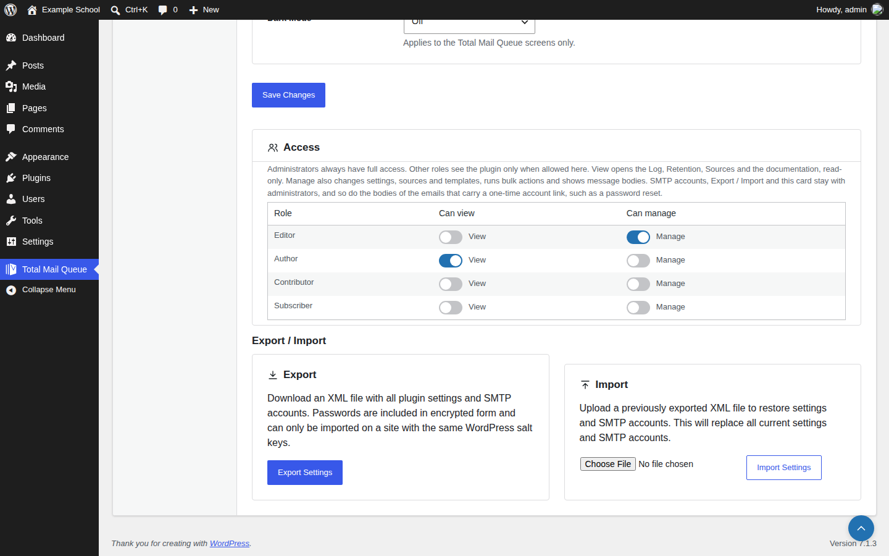
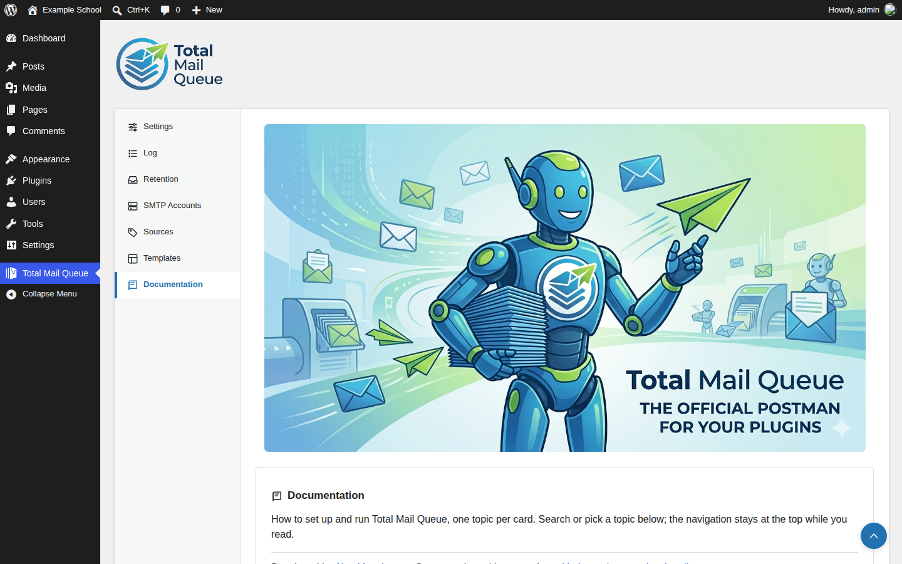
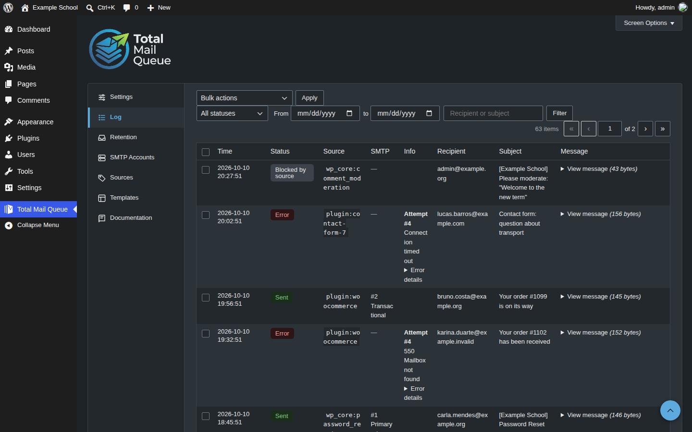

# Total Mail Queue

A WordPress plugin that puts every email the site sends through a managed queue. It sends at the pace you set, through the SMTP accounts you choose, within their daily and monthly limits, and keeps a searchable log of what went out. If the site starts sending far more than usual, for example because a spam bot is submitting a form, it warns you and can stop sending until you have looked.

The complete reference ships inside the plugin, under **Total Mail Queue → Documentation**.

**Requires** WordPress 5.9 or later and PHP 8.1 or later · **License** GPLv3 or later

## Queue and log

The plugin intercepts `wp_mail()`. The **Operation Mode** decides what happens next:
- **Queue** stores each message and sends a set number per interval through WP-Cron.
- **Block** holds everything until you switch back.
- **Disabled** leaves WordPress mail alone.

Failed messages are retried up to a limit you set, and you can resend them from the log. The Log and Retention lists filter by status, source, text and date range.

## SMTP accounts

Add as many SMTP accounts as you need, each with a priority and daily and monthly sending limits. Test a connection before using it. When an account reaches its limit, the next one takes over, and an account can be kept switched off in reserve. Passwords are stored encrypted. Without any account, the plugin keeps whatever delivery the site already uses.

## Sources

Every email is tagged with the plugin or WordPress feature that sent it, such as WooCommerce, Contact Form 7 or password resets. New sources are detected on their own. For each source you can:
- switch it off, so its mail is held as "Blocked by source";
- give it a priority, so password resets go first;
- send it through a preferred SMTP account.

## HTML templates

Wrap plain-text and HTML mail in one template with your own header, footer and colours. Tokens such as `{site_title}` and `{site_url}` are filled in. A live preview beside the form shows a sample email as you edit, before you save.

## Alerts and access

- **Alerts.** You get an email when the queue grows unexpectedly or when WordPress cannot send. With **Block on alert** on, the alert also switches the site to Block, so a flood stops until someone has looked. Password resets still go out unless you turn that off.
- **Access.** Administrators always have full access. They choose which other roles may view the plugin and which may manage it. SMTP accounts, Export / Import and one-time account-link emails stay administrator-only.

| Settings | Access |
| --- | --- |
|  |  |

## More

- **Export / Import:** plugin settings and SMTP accounts move between sites as an XML file.
- **Documentation:** a built-in tab that explains every screen and setting.
- **Dark mode:** for the plugin's own screens, either always on or following the operating system.

| Documentation | Dark mode |
| --- | --- |
|  |  |

## Installation

1. Download `total-mail-queue-X.Y.Z.zip` from the [latest release](https://github.com/rpgmem/total-mail-queue/releases/latest).
2. In WordPress, go to **Plugins → Add New → Upload Plugin**, choose the zip and activate it.
3. Open **Total Mail Queue → Settings**, set the Operation Mode to Queue and choose how many emails to send and how often.

Later updates arrive through the normal WordPress update screen, straight from this repository's releases. Each package is checked against its SHA-256 before it is installed.

The queue is sent by WP-Cron, so make sure it runs reliably. On a site behind a page cache, or with little traffic, call `wp-cron.php` from a server cron job every few minutes.

## Documentation and credits

- [CHANGELOG.md](CHANGELOG.md): what changed in each release.
- This plugin is a fork of [Mail Queue](https://wordpress.org/plugins/mail-queue/) by WDM.

Every screenshot above comes from a throwaway WordPress filled with invented people and data. `.github/scripts/screenshots/` holds the two scripts that rebuild them: `seed.php` and `capture.mjs`.
